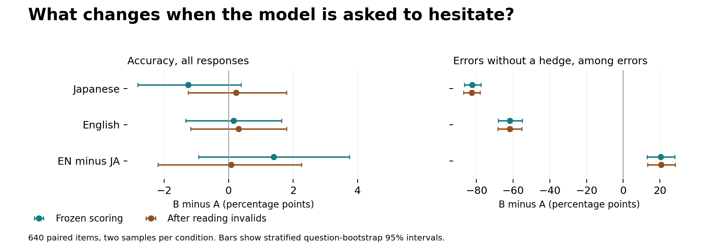

# 同じ640問で「言い淀んで」と頼むと、日本語と英語で何が変わるか

2026年11月24日。GPT-4.1 mini による英語追試。

英語でも、言い淀むよう頼むと誤答に留保が付き、自己申告する正答確率が下がった。正答率への影響は小さかった。最も目についた言語差は、答えを出した後の書き換えである。同じ誤選択肢Bを保った物理の一例（conceptual_physics/028、1回目）では、次の文が生成された。

> えっと、相対性理論が当てはまるのは、えーと、B、だと思いますけど、あの、ちょっと自信はなくて…

> It seems that the theory of relativity might apply to B, but I'm not entirely sure.

## 正答率と留保

言語ごと、条件ごとの分母は1,280出力。正答率の分母には形式無効や棄権も含む。右の2列の分母は、四択の記号を抽出でき、かつ誤答と判定した出力。留保は各言語で実行前に固定した語形辞書で判定した。

| 条件 | 日本語 正答率 | 英語 正答率 | 日本語 誤答中の留保なし | 英語 誤答中の留保なし |
|---|---:|---:|---:|---:|
| A 通常 | 75.47% | 75.08% | 303/305（99.3%） | 302/302（100%） |
| B 事前に言い淀む | 74.22% | 75.23% | 50/293（17.1%） | 114/298（38.3%） |
| C 不確かな場合だけ留保 | 76.02% | 75.86% | 296/302（98.0%） | 287/288（99.7%） |
| D 明確に断定 | 75.16% | 76.48% | 305/309（98.7%） | 280/280（100%） |
| E 通常の発言を事後に書き換え | 75.39% | 75.70% | 8/305（2.6%） | 0/301（0%） |

英語のB−Aの正答率差は **+0.16ポイント**（95%区間 −1.33〜+1.64）。日本語の−1.25ポイントとの差は **+1.41ポイント**（−0.94〜+3.75）。無効回答を文意で読み直すと、B−Aは英語 **+0.31**、日本語 **+0.23**、言語間の差は **+0.08ポイント**（−2.19〜+2.27）だった。今回の比較から、どちらの言語で正答率がより改善するかは判別できない。

誤答中の留保なし率に対するB−Aは英語 **−61.74ポイント**、日本語 **−82.28ポイント**。この減少幅は英語の方が **20.53ポイント小さかった**（差の95%区間 +13.06〜+28.14）。区間は、両言語・全条件・両反復の対応を保ち、科目内で設問を復元抽出した10,000回のブートストラップによる。日英それぞれの区間の端を引いて求めた値とは異なる。

## 同じ誤選択肢での自己申告

英語で通常条件と事前指示条件が同じ誤選択肢を出した220組では、モデルの平均申告確率は **91.3%から80.5%** に下がり、132組で留保語が新たに現れた。日本語の同じ集計では216組、**90.7%から79.0%**、新たな留保178組だった。両言語で、選んだ答えを揃えても数字の申告が動いた。これは各言語内で同じ答えになったペアに限定した記述で、言語間で同一の誤答集合に条件付けた値ではない。

英語の有効回答全体ではBrierスコアはAの0.203からBの0.174、等幅10ビンのECEは16.9%から6.8%に下がった。Aでは平均93.0%の確率を申告し、有効回答時の正答率は76.1%。Bでは平均83.1%と正答率76.4%だった。[英語の全条件の集計](experiments/en/results/summary.csv)

## 書き換えで起きたこと

英語Eでは、形式無効を読み直した後、回答を同定できた **1,279/1,279組** すべてで元の選択を保った。残る1組は選択肢を同定できず保留。判読できた元の誤答303件すべてに新しく留保語が付いた。日本語では選択または棄権を1,280/1,280組で保った。

有効なEの発言で、フィラーや三点リーダーを数える辞書への一致は日本語 **1,269/1,270**、英語 **1/1,270**。英語の唯一の一致を個別に見ると “1⋅2⋅...⋅9” の数式だった。したがって、この辞書が拾った英語の発話上のためらいは **0件**。一方、英語Eの1,269/1,270件に “I think” や “might” などの留保語があった。文字で表した書き換えなので、音声のポーズは測定していない。

## 実施条件と点検

- 日本語版は11月22日、英語版は11月24日に実施。両方とも gpt-4.1-mini-2025-04-14、温度0.7、top_p 1、上限160出力トークン。8科目×80問、固定した選択肢順・正解キー・同じ問題順シャッフル、各条件2回。A〜Dは発言の後に自己申告確率、EはAの発言だけを別会話で編集した。英語評価は3,840成功要求、6,400出力で、全件通常終了。主解析の凍結はローカルで行った。[英語プロトコル](experiments/en/protocol.md) · [英語指示と辞書](experiments/en/code/design.py)
- 英語の形式無効はAから順に17、19、21、21、10件。全88件を条件名・正解キーを伏せて実験担当AIが読み直し、87件で選択を復元。「A galvanometer ... so the answer is C」のように文頭の冠詞が選択肢の記号にも一致した例があった。別に用意した80件の盲検点検では、同じAIによる留保の読解と英語辞書が79件で一致した。人間の確信評価は実施していない。[読み直し後の集計](experiments/en/results/sensitivity.csv)
- 英語版は元の日本語問題と選択肢を、正解を見せず1問ずつ機械翻訳した。社会学の1問で「資本文化」と「文化資本」がともに “Cultural capital” に訳された。英語成績を見る前にこれを記録し、前者だけを “Culture of capital” に直してその問の10出力を追加取得した。初版の640問を主解析として保存した。差し替え後も主解析の正答率に対する言語間の差は+1.41ポイント。留保なし率に対する言語間の差は+20.79ポイントだった。他の英訳の意味の同等性には抜き取り確認の限界がある。[修正版の記録](experiments/en/correction/protocol.md)
- 2日間の別々のサンプリングであり、設問・指示・辞書も翻訳している。今回の結果は、このモデルと翻訳した実験条件での言語差を示す。話者一般の性質や、モデル内部の確信の大小を決めるものではない。
- 前回と同じ単価換算で、英語評価の成功応答は0.522018米ドル、翻訳は0.123306米ドル、修正1問は0.000679米ドル、計約 **0.65米ドル**。英語評価に通信再試行が1回あり、その試行の課金有無は未確定。ローカル台帳の未精算予約を含めても推計は丸めて同額。[比較値・区間・費用のデータ](comparison.json)
