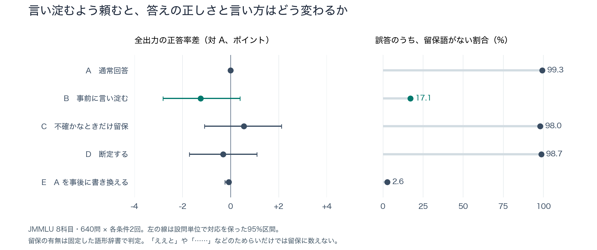

# 「言い淀んで」と頼むと、答えは変わるか

2026年11月22日 ／ OpenAI API ／ 日本語四択640問・5条件・各2回

事前に「自信満々に言い切らず、必要に応じて言い淀んでください」と頼むと、**誤答に「たぶん」「と思います」などの留保語が付かない割合が99.3%から17.1%に下がった**。同じ指示による全出力の正答率差は **−1.25ポイント**（設問単位の対応95%区間 −2.81〜+0.39）。固定した記号抽出器が読み取れなかった回答を文意で採点し直すと、差は **+0.23ポイント**（−1.25〜+1.80）だった。

## 同じ設問で何が起きたか

アンドロメダ銀河までの距離を問う設問で、通常条件と事前指示条件はともに選択肢Aの約170万光年を選んだ。正解キーはCの約250万光年で、NASAの記載とも合う。以下は astronomy/073 の2回目の実出力である。[NASAによるM31の距離](https://science.nasa.gov/asset/hubble/andromeda-galaxy-m31-mosaic/)

| 条件 | 実際の発言 | 申告した正答確率 |
|---|---|---:|
| A 通常 | 「アンドロメダ銀河の距離はAです。」 | 95% |
| B 事前に言い淀む | 「アンドロメダ銀河の距離は、たしかAの約170万光年だったと思います。」 | 85% |
| E 上のAを事後に書き換え | 「えっと、アンドロメダ銀河の距離は、まあ、たぶんAだと思いますが…」 | 測定対象外 |

同一設問・同一反復番号でAとBが**同じ誤選択肢**を出した216組を取り出すと、178組ではAに無かった留保語がBに現れた。この216組の平均申告確率も **90.7%から79.0%** に下がった。同じ正解を出した910組でも92.0%から82.8%に下がった。出力した数値も指示に反応している。この実験で直接測ったのは、書かれた確率と選んだ答えとの対応である。

## 5条件の正誤と棄権

各条件の分母は1,280。主解析では、本文からA〜Dのいずれか一つを抽出し、公開正解キーと照合した。「棄権」のみを表明した回答は棄権、複数記号、記号の欠落、打ち切りなどは形式無効とした。有効回答時の正答率は正答数を「正答数＋誤答数」で割った値である。

| 条件 | 正答 | 誤答 | 棄権 | 形式無効 | 全出力正答率 | 有効回答時の正答率 | 誤答中の留保語なし |
|---|---:|---:|---:|---:|---:|---:|---:|
| A 通常 | 966 | 305 | 1 | 8 | 75.47% | 76.00% | 303/305（99.3%） |
| B 事前に言い淀む | 950 | 293 | 1 | 36 | 74.22% | 76.43% | 50/293（17.1%） |
| C 不確かな場合だけ留保 | 973 | 302 | 0 | 5 | 76.02% | 76.31% | 296/302（98.0%） |
| D 明確に断定 | 962 | 309 | 0 | 9 | 75.16% | 75.69% | 305/309（98.7%） |
| E Aを事後に書き換え | 965 | 305 | 1 | 9 | 75.39% | 75.98% | 8/305（2.6%） |

全1,280出力に占める「誤答かつ留保語なし」の割合も、Aの23.67%からBの3.91%に下がった。差は−19.77ポイント（95%区間 −22.58〜−16.95）。Bでは正答の78.7%にも留保語が付いた。誤答を選択的に知らせる合図として読むには、正答にも付くこの頻度が効いてくる。

AとBの両方で選択または棄権を抽出できた1,240組中、同じ答えは1,126組（90.8%）。Aを同じ指示で2回生成した場合の一致は581/633組（91.8%）だった。AとBで正答から誤答に変わったのは41組、誤答から正答に変わったのは38組。個別の変化には、同じ指示で生成し直しても生じるばらつきが含まれる。

## 「たぶん」と「ええと」は別々に動いた

固定辞書で「たぶん」「かもしれない」「と思います」などを認識上の留保、「えっと」「うーん」「……」などをためらいの表現として数えた。両方を含む文もある。以下の分母は選択を抽出できた有効回答である。

| 条件 | 留保語あり | ためらいの表現あり | 発言の平均文字数¹ |
|---|---:|---:|---:|
| A 通常 | 35/1,271（2.8%） | 0/1,271（0.0%） | 21.7 |
| B 事前に言い淀む | 991/1,243（79.7%） | 6/1,243（0.5%） | 38.2 |
| C 不確かな場合だけ留保 | 42/1,275（3.3%） | 0/1,275（0.0%） | 22.9 |
| D 明確に断定 | 42/1,271（3.3%） | 0/1,271（0.0%） | 23.0 |
| E 事後に書き換え | 1,243/1,270（97.9%） | 1,269/1,270（99.9%） | 37.5 |

¹ 文字数は本文を取得できた発言すべての平均。Bでは「と思います」のような表現が増え、フィラーは少なかった。事後書き換えでは両方が現れた。Bの指示には「必要に応じて」が入り、Eには書き換えを明示的に要求した。BとEの差には指示の強さと課題の違いも寄与しうる。

5条件それぞれから正答と誤答を8件ずつ抽出し、計80件について条件名・正誤・辞書判定を隠して、実験担当AIが発言だけを読んだ。選択に留保がかかるか判定できた78件中77件で辞書と一致した。「A、ですかね。」に含まれる留保を辞書が1件見落とした。伝聞表現と理由部分だけを弱めた表現が各1件あり、いずれも曖昧とした。ためらいの判定は80件で一致した。同じAIによる小規模な点検で、人間の聞き手が感じる確信の強さは未測定である。

## 自己申告した確率の較正

発言を書いた後に同じ応答の別欄で「選んだ答えが正しい確率」を0〜100の整数で申告させた。Brierスコアは予測確率と正誤（0/1）の二乗誤差の平均。ECEは10個の等幅ビンで、各ビンの平均申告確率と実正答率の差の絶対値を件数で重み付けした。どちらも小さいほどよい。Eは元発言だけを編集するため、申告を求めていない。

| 条件 | 有効件数 | 平均申告 | 正答時 | 誤答時 | Brier | ECE |
|---|---:|---:|---:|---:|---:|---:|
| A 通常 | 1,271 | 91.7% | 92.0% | 90.7% | 0.203 | 15.7% |
| B 事前に言い淀む | 1,243 | 81.7% | 82.6% | 78.8% | 0.172 | 6.0% |
| C 不確かな場合だけ留保 | 1,275 | 91.4% | 91.7% | 90.4% | 0.200 | 15.1% |
| D 明確に断定 | 1,271 | 93.3% | 93.5% | 92.6% | 0.213 | 17.6% |

Bのほうがこの標本では申告確率と実績が近かった。同時に「正答時と誤答時の平均申告の差」はBでも3.8ポイントにとどまる。条件によって有効回答の集合も少しずつ異なる。

## 形式無効67件の読み直し

自動抽出では、「ここではDを選びます」と言っていても、その前にCに触れると形式無効になる。「Bの2 Aです」では選択肢のBと電流単位のAも衝突した。Bで無効が36件、Aで8件あったので、**主解析を保存した後で**、全条件の形式無効67件を読み直した。条件・正解キーを隠した点検票を使い、最終的に選んだと明記した記号、または選択肢と一意に一致する文言を採用した。点検者は同じAIで、一部の例を先に見ている。

60件で選択肢、1件で棄権を復元できた。残る6件はすべてBでのトークン上限による打ち切りで、構造化された回答文を取得できなかった。6件も全出力正答率の分母に残した。

| 読み直し後 | 正答 | 誤答 | 棄権 | 未解決 | 全出力正答率 |
|---|---:|---:|---:|---:|---:|
| A 通常 | 971 | 308 | 1 | 0 | 75.86% |
| B 事前に言い淀む | 974 | 299 | 1 | 6 | 76.09% |
| C 不確かな場合だけ留保 | 978 | 302 | 0 | 0 | 76.41% |
| D 明確に断定 | 968 | 311 | 1 | 0 | 75.63% |
| E 事後に書き換え | 971 | 308 | 1 | 0 | 75.86% |

EはAの発言だけを入力に受け、問題文も候補一覧も見ていない。主解析で両側が判読できた1,270組はすべて記号または棄権が一致した。読み直し後は **1,280/1,280組で元の選択または棄権を維持**した。Aの誤答308件のうち297件で、誤選択肢を保ったまま、それまでなかった留保語が加わった。各発言に含まれる説明の細部まで同義かは採点していない。

## 設計と解釈の範囲

- 問題は天文学、概念物理、高校統計、高校数学、日本史、高校地理、社会学、哲学の8科目から各80問を有効行内で無作為抽出した。問題と選択肢の組は640通り。選択肢順は原文のまま。採点は公開キー基準で、翻訳や選択肢には曖昧さが残る。例えば conceptual_physics/025 では、速度を2倍にしたとき運動エネルギーが4倍になる場合、選択肢Aの「増加するが、2倍にはならない」とCの「2倍以上になる」がともに成立する。キーはAで、全条件で同じキーを用いた。[JMMLU の固定リビジョン](https://github.com/nlp-waseda/JMMLU/tree/762cbf192c9e4588b574d718f95afd64c96fcbf4)
- 全条件で gpt-4.1-mini-2025-04-14、温度0.7、top_p 1、出力上限160トークン。A〜Dは1要求あたり2生成で要求順をシャッフルし、Eは各A発言に対して個別に1生成した。APIが返したモデル名は全件一致し、バックエンドの fingerprint は26種類だった。
- 主要比較はB−Aの全出力正答率差。問題・指示・採点規則を最初のモデル応答より前にローカルで固定した。95%区間は8科目それぞれで80問を復元抽出し、同じ設問の条件・反復を一緒に動かした10,000回のブートストラップ。主解析、読み直しの両区間とも事前に目安とした±3ポイントの内側にある。他条件や文体指標の比較は探索的である。
- このモデル・設問・日本語指示で、指示を変えると表現と自己申告確率が動き、選択の正答率には小さな差が残った。自由記述での架空の事実や出典、人間が感じる誠実さ、学習時の強化の寄与、モデル内の推論過程や信念は測定範囲外である。「Xとは何ですか」と「私はXだと思うけど、どう思う？」という質問者側の言い回しも、今回は独立に操作していない。
- 成功したAPI要求は3,840件、出力は6,400件。通信再試行は0件。入力970,352トークン（キャッシュ0）、出力193,762トークン。通常単価に基づく推計は **US$0.69816**。利用明細上の確定額との突合は行っていない。[OpenAI のモデル仕様と単価](https://developers.openai.com/api/docs/models/gpt-4.1-mini)
