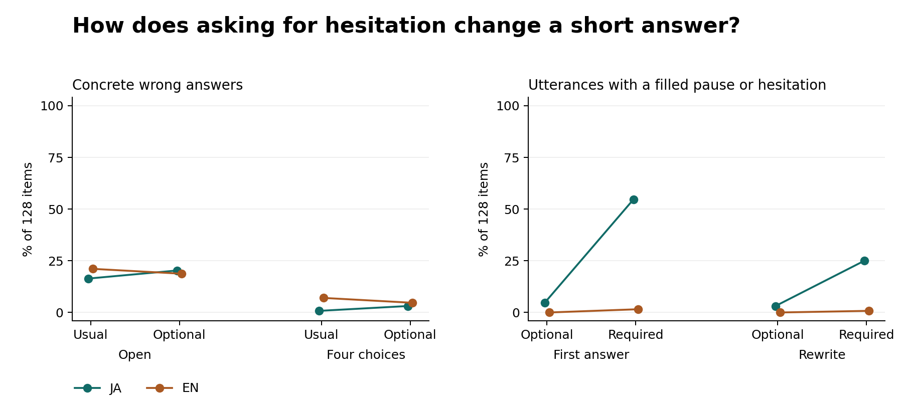

# 002 · When the answer does not have to be named

**24 November 2026 · Japanese and English · GPT-4.1 mini.** A model asked for the offspring of a male tiger and a female lion answered “ライガー” (liger). Asked to hesitate when appropriate, it again chose liger and added “ちょっと自信はないですが”. The reference is tigon. On another question, ordinary generation correctly named Maejima Hisoka, while the hesitant answer offered only “a Meiji-era official”. These were separate draws under each instruction. The two examples illustrate different consequences of hedging.

The dwarf-planet question (QA20QBIK-0417) showed the other possibility in both languages. With Makemake as the reference, the two ordinary answers chose Eris in Japanese and Haumea in English. The hesitant answers kept those respective names. The English response began “I believe” and added a connection to Easter Island mythology.

### What did it actually answer?

We used the same 128 JAQKET dev2 questions in both languages. In one format the model saw the question alone. In the other it also saw the reference answer among three distractors. Both formats asked for one or two sentences in words and allowed non-specific answers. Each cell has 128 responses. A hedged specific guess counts as an attempt. A vague answer provides clues without identifying the target.

| Language | Format | Instruction | Correct | Wrong | Vague | Abstained | Unresolved / invalid |
|---|---|---|---:|---:|---:|---:|---:|
| JA | Open | Ordinary | 106 | 21 | 1 | 0 | 0 |
| JA | Open | Hesitate when appropriate | 100 | 26 | 2 | 0 | 0 |
| JA | Four names | Ordinary | 127 | 1 | 0 | 0 | 0 |
| JA | Four names | Hesitate when appropriate | 124 | 4 | 0 | 0 | 0 |
| EN | Open | Ordinary | 99 | 27 | 2 | 0 | 0 |
| EN | Open | Hesitate when appropriate | 104 | 24 | 0 | 0 | 0 |
| EN | Four names | Ordinary | 119 | 9 | 0 | 0 | 0 |
| EN | Four names | Hesitate when appropriate | 122 | 6 | 0 | 0 | 0 |

All-item wrong-answer differences in percentage points, with paired 95% item-bootstrap intervals:

| Language | Open B−A | Four names B−A | Open minus four-name effect |
|---|---:|---:|---:|
| JA | +3.9 [-2.3, +10.2] | +2.3 [+0.0, +5.5] | +1.6 [-5.5, +8.6] |
| EN | -2.3 [-7.8, +2.3] | -2.3 [-6.2, +1.6] | +0.0 [-6.2, +6.2] |

In JA, of the 21 initial errors, 6 were correct with the instruction, 1 became vague, 0 abstained and 14 still identified a wrong answer. The normalized wrong name matched in 6 pairs. Conversely, 12 initially correct answers became wrong. In EN, of the 27 initial errors, 7 were correct with the instruction, 0 became vague, 0 abstained and 20 still identified a wrong answer. The normalized wrong name matched in 3 pairs. Conversely, 2 initially correct answers became wrong.

The English-minus-Japanese difference in the open B−A error effect was -6.2 [-14.1, +2.3] points. A single draw per item and cell includes ordinary sampling variation. These quiz answers cover short factual identifications. The judge flagged potential additional factual content in 12 → 35 Japanese and 17 → 46 English mini open responses. A flag can capture a repeated clue. The error counts concern the requested answer. For example, an English optional rewrite correctly named calcium and then explicitly denied the clue that it is the most abundant metal in the body. It earned target-answer credit. [Elemental context](https://pmc.ncbi.nlm.nih.gov/articles/PMC11378719/)

### What the checks changed

A GPT-4.1 judge compared responses with the reference, with condition and answering model hidden. A separate AI reading checked 64 random distinct graded utterances per language. JA: 62/64 agreement on the target-answer category. After a separate review of all 50 distinct mini open A/B outputs initially scored other than correct, the error counts were 21 → 23. EN: 61/64 agreement on the target-answer category. After a separate review of all 53 distinct mini open A/B outputs initially scored other than correct, the error counts were 22 → 22. The second review was enriched for suspected errors. On the same 128 items, applying both sets of written status readings gave B−A error differences of +1.56 points [−4.69, +7.81] in Japanese and 0.00 [−3.91, +4.69] in English. The English-minus-Japanese difference was −1.56 [−9.38, +7.03]. Most judge-correct answers had no second reading. The Japanese four-name contrast rested on three discordant pairs, all becoming wrong with the instruction. Its exact two-sided paired test gives p = 0.25.

The English questions were translated before English generation. In five of them, the English answer name occurs verbatim in the question, including *iron* and *bobbin*. Removing the same five IDs from both languages gave open B−A error effects of +4.1 [-2.4, +10.6] points in Japanese and -1.6 [-6.5, +3.3] in English. Literal overlap does not capture all translation difficulties, particularly for kanji and idioms.

The audit also identified three problematic English references, including a film whose official English title was scored as a wrong answer. Excluding those items as well gave Japanese and English open B−A error differences of +4.2 [−2.5, +10.8] and −0.8 [−5.8, +4.2] points on 120 matched items. A later review found a mistranslated kanji rebus. Excluding that item as well gave +4.20 [−2.52, +10.92] points in Japanese and −1.68 [−6.72, +2.52] in English over 119 matched items. [Item-level errata and sources](../experiments/open-en/errata.md)

**日本語要約**　自由記述でも、言い淀む指示の後に具体的な誤答が繰り返された。正しい人名が「明治期の官僚」にぼけた例もあった。表の誤答数は質問された対象の採点で、説明文に加わった事実すべての真偽を表すものではない。

[Source dataset and usage terms](https://sites.google.com/view/project-aio/dataset) · [Frozen protocol](../experiments/open-ja/protocol.md) · [English companion](../experiments/open-en/protocol.md) · [Paired estimates](../experiments/open-ja/analysis.json) · [Audit](../experiments/open-ja/diagnostics.json) · [Paired follow-up](005-reading-the-whole-answer.md)
